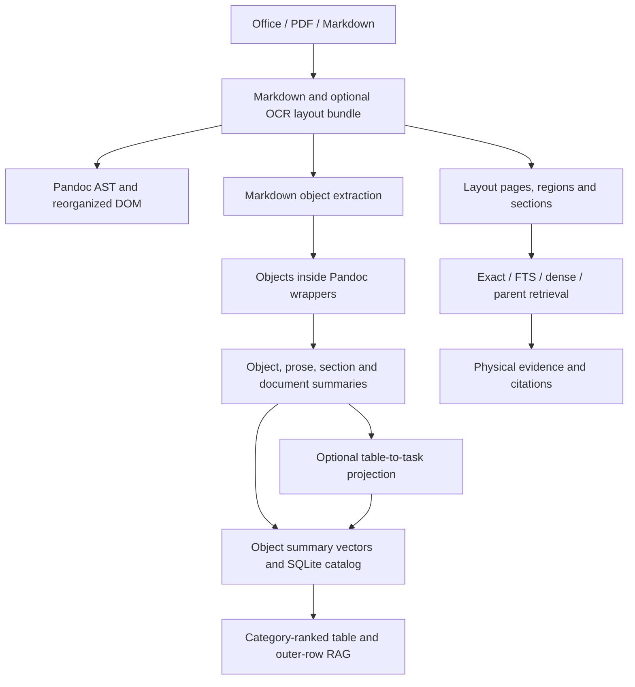
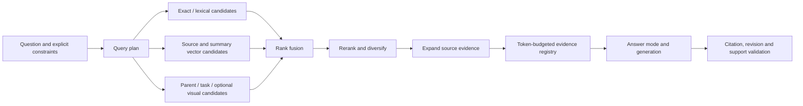

# Notebook algorithm and architecture review

Review date: 2026-11-06. Repository baseline: `8362141`, including the current working tree.

The strongest next step is to unify **source evidence, logical objects, and derived representations** behind one validated document graph and artifact repository. Keep the existing incremental summary processing and immutable object-index generations. Extend object retrieval with the lexical, hierarchical, and citation capabilities already present in the layout pipeline.

The main weaknesses are cross-stage contracts: some producers emit objects that consumers cannot retrieve; different entry points apply different cache rules; object coverage depends on where content occurs; and generation checks formatting more strongly than evidence support. These issues should be fixed before increasing model size, generating more summaries, or rebuilding indexes.

## Scope and evidence

This review inventories all **36 notebooks** directly under `nbs`, compiles their **604 code cells** without executing notebook workflows, and examines the DOM, summary, embedding, object RAG, layout retrieval, and application implementations in depth. OCR provider adapters and Office conversion are reviewed primarily at their representation/provenance boundaries, rather than as an exhaustive audit of every provider request. Supporting `utils` implementations and regression tests are included because the operational notebooks depend on them.

Notebook references below use **zero-based cell positions in the notebook JSON**, together with function names. They are not execution counts. Recommendations are proposals; no pipeline code, notebooks, corpus documents, summaries, checkpoints, or indexes were changed for this review. The pre-existing change in `05.application.embedding.object.ipynb` is kernel/language metadata and was preserved. Its task-mode source configuration is already in the committed baseline.

Findings distinguish:

- **Reproduced:** exercised with temporary files or fake providers, without model requests.
- **Code-confirmed:** follows directly from the reviewed control flow or data contract.
- **Design risk:** a limitation requiring measurement or additional fault testing before claiming a production failure rate.

## Current architecture and strengths



The diagram's task-to-index path exists, but its connection to object RAG is currently incompatible. The two retrieval branches also use different identities, evidence models, and publication protocols.

Several substantial pieces are already correct and worth retaining:

- The object summarizer retains original object markup and Pandoc subtrees, handles recursive table row groups, rich table cells, and nested list items, and summarizes descendants before their parents. This is more capable than a flat chunking pipeline.
- The object-summary application has bounded document/request/traversal concurrency, partial progress, compatible checkpoint reuse, missing-object upgrades, cancellation handling, and atomic replacement of individual output files. It intentionally preserves existing ancestor summaries during descendant additions.
- `ObjectEmbeddingIndex` separates exact source content from summary vectors, keeps unsummarized objects in its catalog, deduplicates embedding computations without merging object identities, validates vector/configuration compatibility, and publishes immutable generations through an active-document pointer.
- Layout ingestion retains raw OCR, cleaned/native text, pages, regions, bounding boxes, assets, and quality flags. The application applies an OCR audit gate before indexing.
- Layout retrieval already implements exact-term/FTS retrieval, dense child and parent retrieval, reciprocal-rank fusion, optional reranking, diversity limits, evidence expansion, and structured citation payloads.
- Object RAG retrieves source content after vector search, records omissions, retains retrieved summaries if generation fails, and supports deterministic evaluation replay. Evaluation utilities distinguish source hits from evidence actually supplied to generation and include separate source-based answer review.

## Prioritized findings

`P1` means a correctness or integration issue to address before expanding the pipeline. `P2` means an architectural, quality, or scaling improvement. Priority describes potential impact, not a claim that every current document is affected.

| ID | Priority | Finding | Evidence status |
|---|---|---|---|
| F01 | P1 | Legacy semantics runners overwrite summaries with the raw AST | Reproduced |
| F02 | P1 | Direct DOM cache reuse can combine new source with old derived artifacts | Reproduced |
| F03 | P1 | Task-mode indexing and object RAG have incompatible path/type contracts | Reproduced |
| F04 | P1 | Completed-output gap checks omit prose, section, and document summaries | Reproduced helper result; code-confirmed routing |
| F05 | P1 | List-contained images bypass visual summarization; nested object coverage is uneven | Reproduced extraction; code-confirmed dispatch |
| F06 | P1 | Citation labels and manual revision are not validated against a structured evidence registry | Reproduced |
| F07 | P2 | Context deduplication can emit an empty, apparently citable evidence block | Reproduced |
| F08 | P2 | Conditioning repeats the initial table header as a body row | Reproduced |
| F09 | P1 | Referenced image changes are absent from summary source signatures | Reproduced |
| F10 | P2 | Summary input size and fidelity have no explicit acceptance contract | Design risk / code-confirmed mechanism |
| F11 | P2 | Summary-only vectors and table-only retrieval leave much of the document unused | Code-confirmed |
| F12 | P2 | Category reranking can discard its eventual winner before applying the bonus | Reproduced |
| F13 | P2 | Retrieval scans the whole active object catalog on every request | Code-confirmed |
| F14 | P2 | Embedding identity does not fully describe effective model and input formatting | Design risk |
| F15 | P1 | Publication guarantees differ across summary files, checkpoints, and layout stores | Code-confirmed failure windows; crash testing needed |
| F16 | P2 | Physical provenance, logical identity, and mutable structural mirrors are disconnected | Code-confirmed architectural limitation |

### F01–F02. Consolidate legacy entry points before relying on their artifacts

In [02.process.semantics.ipynb](../nbs/02.process.semantics.ipynb), cells 10 and 16 (`analyze_one_document_async`, `process_one`) write `dom.ast_json` to `*_semantics.json` after calling `textualize()`. The current implementation in [01.core.dom.model.ipynb](../nbs/01.core.dom.model.ipynb), cells 17 and 33, intentionally leaves the AST unchanged and publishes summary-bearing `semantics_json`. The legacy write therefore replaces the correct semantic artifact with the unsummarized AST.

An offline execution of the actual `process_one` cell with a fake DOM reproduced the overwrite: the fake `textualize()` published a summary, but the final file contained only `{"blocks": [{"t": "Para"}]}`. This is interface drift, not a failure in the newer object-summary application. The legacy notebook also calls `dom.embed()` while the current DOM exposes `embed_doc()`.

Separately, `DOMClass.setup` (model cell 19) parses the current Markdown into `raw_json` but trusts existing AST, semantic, and embedding files by existence. A temporary-file probe produced `raw_json` containing the new source and `ast_json` containing the old source. `embed_doc` (cell 29) skips if `embed_json` is truthy without establishing that the selected index contains the expected vectors.

**Improvement:** retain one supported orchestration path and one artifact publication API; deprecate or adapt these legacy runners. Put source/model/settings compatibility checks in the shared artifact repository so direct callers receive the same guarantees as the application. Validate artifact type and completeness before marking work complete. Existing completed object-summary documents must still be reused under the repository's checkpoint policy; code or schema version changes alone must not trigger rebuilding.

### F03. Treat task as a semantic role, and make producer/consumer contracts explicit

[05.application.embedding.object.ipynb](../nbs/05.application.embedding.object.ipynb), cell 2, defaults to `USE_TASKS=True`, discovers `*_tasks.json`, and uses a separate task embedding directory. [01.core.dom.summary.task.ipynb](../nbs/01.core.dom.summary.task.ipynb) creates this projection by changing a qualifying table's `type` to `task` while preserving its content, descendants, and summaries.

The reader in [01.rag.object.ipynb](../nbs/01.rag.object.ipynb) does not share this contract:

- `canonical` (cell 4) removes `_semantics.json` and `.md`, but leaves `_tasks.json`. A mapped `manual` therefore fails to match `manual_tasks.json`.
- `ObjectRAG.retrieve` (cell 6) admits `table` and outer `table_row` objects whose owning parent is a `table`; `task` and rows beneath a `task` fail that eligibility test.
- The RAG application independently defaults to an existing object index directory, so running the default embedding notebook does not automatically update the index it reads.

A temporary catalog probe found zero mapped documents with the task suffix; after correcting only the mapping, it found one mapped document but zero hits and made zero vector queries.

**Improvement:** add a manifest declaring artifact kind, source identity, supported object kinds, representation, and active index generation. Fail preflight on incompatible combinations. Prefer `kind="table", semantic_roles=["task"]` to changing the structural type: table parsing, row ownership, and evidence expansion should continue to work when semantic labels are added. Task detection reasons can be stored as annotation provenance. Keep the existing projection readable through a compatibility adapter rather than rewriting completed summaries.

### F04. Completed checkpoints need a whole-document completeness audit

The completed-document branch of [utils/summary_object_asyncio.py](../utils/summary_object_asyncio.py), `process_document` around lines 527–562, calls `_prepare_incremental_tree`, which plans work through object nodes. If no object work or structural changes are found, the function returns the saved completed result. It does not check missing ordinary prose `s`, section `s`, or the document `summary` before that return. The later document-summary validation is bypassed.

This means a *signature-compatible* saved artifact with a non-object summary gap can be reported complete, and an object upgrade does not itself repair these other gaps. This is narrower than saying resume is broken: existing object descendant repair and partial-resume traversal are useful and should remain.

An isolated helper probe supplied a complete list object inside a section with empty `s`, and an empty document `summary`, without skip markers. `_prepare_incremental_tree` returned `([], 0, False)`, selecting that early-return condition. The full batch path was not successfully exercised in this probe.

**Improvement:** introduce a pure `audit_completeness(document, required_capabilities)` function that inventories object descendants, prose, sections, and document summaries. Its result should distinguish `present`, `missing`, `intentionally_ignored`, and `intentionally_skipped`. Feed only missing work into a dependency-aware fill plan, preserve every existing summary, and publish the completed upgrade atomically. Add fixtures with complete objects but missing prose, section, or document summaries. Never use the implementation version as a reason to invalidate the corpus.

### F05. Object and vision coverage depends on syntactic placement

In [01.core.dom.summary.object.ipynb](../nbs/01.core.dom.summary.object.ipynb), cell 30, `_extract_markdown_objects_with_spans` primarily extracts top-level MarkdownIt tokens. In [01.core.dom.summary.object_utils.ipynb](../nbs/01.core.dom.summary.object_utils.ipynb), cell 10, `_list_item_records` creates nested item objects with `images=[]`. A list containing `` therefore yields a list and item but no figure child. The object's early-return summary path (object notebook cell 25) does not subsequently walk the preserved Pandoc image; the list item uses a text prompt. Alt text may survive, but the visual content is not analyzed through that path.

A table inside a blockquote also produced no typed object in the extraction probe. An inline image in ordinary prose may still be handled by the generic AST summarizer, but does not become a first-class figure object for the object index. These cases must be distinguished from complete loss of raw content, which is generally retained.

**Improvement:** use one recursive semantic walker with explicit ownership rules for paragraphs, blockquotes, lists/items, table cells, figures, code, and formulas. A figure's eligibility for visual interpretation should not depend on whether it occurs at top level or inside a list. Extend saved documents by adding missing descendants and summaries, retaining all existing outputs and checkpoint compatibility.

### F06–F07. Build evidence as structured records before rendering the prompt

`ObjectRAG.answer` (object RAG cell 6) constructs its allowed citation set with a regex over the entire context string. A literal `[E999]` inside source content becomes an allowed label even though the context assembler never issued evidence item `E999`. The generated `manual` is an unrestricted string, and the validator does not reconcile it with the profiles and revisions of the cited objects.

A fake generator response citing the source's literal `E999` and declaring `Invented revision 99.0` was accepted with `example_status="included"` and rendered both values. This demonstrates an evidence-validation defect without requiring an adversarial model. Counting three distinct code lines also cannot establish that those lines are valid statements, demonstrate the requested instruction, or use compatible syntax; the notebook documentation already acknowledges this limitation.

In `retrieve`, text deduplication uses a global `used` set of content strings. Two distinct objects with identical content can yield a complete `[E1]` block and a header-only `[E2]` block. The second label remains available to generation. Repeated content is legitimate across occurrences and manual revisions; string equality is insufficient evidence identity.

**Improvement:** construct `EvidenceItem` records with issued ID, object/revision IDs, exact spans, source hashes, included text, and expansion provenance. Derive allowed citations from that registry only. Deduplicate by evidence/span identity; when equivalent text is shared, explicitly retain all source attributions. Never issue a label for an empty block. Derive the displayed manual/revision from cited metadata and reject incompatible combinations. Add claim-to-evidence checks separately from response-shape validation.

### F08. The first conditioned table header is duplicated

[02.preprocess.conditioning.markdown.ipynb](../nbs/02.preprocess.conditioning.markdown.ipynb), cell 7, `_render_table_component`, takes `incoming[0]` as the initial header, initializes `current_rows` with it, then appends `incoming` without removing its first row. Header removal is in the branch for later fragments. A two-row HTML table becomes:

```text
| Name | Value |
| --- | --- |
| Name | Value |
| A | 1 |
```

This creates a spurious data-row object in the derived table for downstream extraction, summaries, and citations; the original HTML is unchanged. Remove a recognized header exactly once, and preserve headerless tables rather than always treating row zero as a header. Test the full renderer across one-page and continued tables, not only row-chunking helpers.

### F09–F10. Summary compatibility and fidelity need explicit input contracts

`SummaryCheckpoint.signature` in [utils/summary_asyncio.py](../utils/summary_asyncio.py) hashes Markdown and adjacent AST/semantics artifacts, but not the bytes of ordinary image assets referenced by the Markdown. The ignored-image reference set has its own compatibility signature; that does not cover the actual diagrams being summarized. Replacing `diagram.png` without changing its path or the Markdown can leave the saved visual summary eligible for reuse. A temporary-file probe changed the image bytes and observed an identical checkpoint signature.

**Improvement:** include referenced asset fingerprints in the source manifest, with explicit unavailable/remote asset states. Preserve the current Markdown/output/model/settings checks. Treat changed image content as changed input, while retaining the no-rebuild rule for code/schema-only changes. For old checkpoints lacking asset hashes, record provenance as unknown and adopt a deliberate compatibility transition; do not silently assume historical asset identity or reset every completed document.

Summary input construction also needs a budget. The object summarizer (object notebook cell 30; object-utils cells 8 and 10) combines raw object content and descendant summaries, then summarizes parents and the document. A large table may be sent in full while its row descriptions are also included. Across deep structures, source content participates repeatedly in ancestor requests. Output token limits and concurrency limits do not bound input length or total work. Language length heuristics are not tokenizer budgets. Provider adapters in [01.core.dom.utils.ipynb](../nbs/01.core.dom.utils.ipynb), cells 26, 30, and 34, return content without preserving completion reason, so a nonempty truncated response has no explicit completeness rejection at that boundary.

There is no general guarantee that a nonempty summary preserves identifiers, numerical bounds, units, negations, prerequisites, or version-specific syntax. A free-text summary can be useful for navigation while omitting the one fact a later query needs. Existing `summary_ignored` and `summary_skipped` flags are useful; generated text, short-text copies, empty-response fallback, truncation, and dependency coverage still lack a unified artifact status.

**Improvement:** budget every request in model tokens, reserve output/headroom, and use bounded reductions over child artifacts for oversized parents. Keep exact facts in source-backed fields and use summaries for semantic access. Store summary provenance and covered child IDs. Existing parent summaries must remain unchanged when new descendants are added; mark their recorded coverage accurately and allow retrieval to use the new descendants directly. Do not regenerate ancestors merely to make them reflect a schema upgrade.

### F11–F12. Improve retrieval recall before relying on category reranking

[01.core.dom.embedding.object.ipynb](../nbs/01.core.dom.embedding.object.ipynb), cells 3 and 5, indexes nonempty object/document `summary` fields. Section/prose `s` fields are context, not independently retrievable records. Source content is preserved but is not used as a separate exact-text or lexical retrieval representation in object RAG. Identical summaries can correctly remain distinct catalog records while still producing indistinguishable vectors.

Object RAG then restricts candidates to tables and outer rows. Lists, procedures in prose, figures, code blocks, nested table rows, sections, and document summaries cannot directly win retrieval through this application. This is an explicit design boundary in the current notebook, but it is too restrictive for general document-object RAG. Adding more summaries alone does not overcome a downstream type filter.

The category bonus in [05.application.rag.object.ipynb](../nbs/05.application.rag.object.ipynb), cell 2, is applied after a global cosine shortlist of `4 * top_k`. For `top_k=1`, four other-category distances `0.10, 0.11, 0.12, 0.13` exclude a matching-category object at `0.14`. With the default `0.15` bonus, the excluded object would score `1.01`, above the retained best score `0.90`. An isolated probe returned the wrong winner under the intended boosted objective. Overfetching reduces this problem but cannot guarantee its absence.

**Improvement:** use independently budgeted channels for exact identifiers, lexical content, source-text vectors, summary vectors, and parent/task candidates. Fuse before reranking and reserve category-specific candidates rather than depending on a single global shortlist. Distinguish hard revision/corpus constraints from soft topical preferences. Keep category confidence and raw scores observable. Support different answer modes for instruction syntax, GUI procedures, troubleshooting, comparisons, and document overviews; requiring a three-statement code example for every successful answer artificially narrows the application.

### F13–F14. Make the serving path and embedding contract explicit

`ObjectRAG.snapshot` deserializes every object in every active generation on each request, before filtering categories and profiles. The catalog includes exact content and a document record containing the original semantic JSON. `retrieve` then queries eligible vector IDs in batches of 256 and combines results in Python. Its memory/CPU cost therefore grows with the whole active corpus, not just the requested evidence. The generic `ObjectEmbeddingIndex.search` has a lighter but related scaling issue: it scans active-document metadata and issues one vector query per 100 generations, rather than deserializing every object. Synchronous SQLite and Chroma calls also run inside the asynchronous request paths.

The configured example catalog was approximately **2.2 GB** on disk during review. This is a size observation, not a measured per-query memory or latency result. The existing evaluation snapshot cache is helpful for a frozen run but does not replace a production serving design.

**Improvement:** normalize filterable metadata into indexed columns, preselect compatible document generations, and retrieve only necessary record IDs and evidence payloads. Keep large raw JSON/source blobs separate from hot catalog metadata. Use generation-aware filter pushdown and measure ANN recall against an exact small-corpus baseline. Batch index writes instead of one Chroma upsert per object; isolate synchronous storage work from the event loop. Add generation retention and orphan cleanup with a grace period, preserving active readers and rollback targets.

Corpus lifecycle needs an explicit synchronization contract as well. A temporary-file probe indexed a source, deleted it, and reran `index_paths` on its now-empty existing folder: the result was `[]`, while the document remained active. This is a missing synchronization feature, not a violation of an API promising deletion. A move can similarly leave both path-derived identities active. Use authoritative corpus manifests, relocation aliases, and explicit tombstones for confirmed removals; never treat a failed or partial discovery run as permission to delete indexed documents.

The object index's fingerprint uses the requested model string and caller-supplied `embedding_config`; this is valuable but not a complete effective encoder identity. Actual model tags are recorded, while a mutable tag or differently provisioned pooled servers can still produce same-dimensional vectors from different model contents. A caller's configuration dictionary also does not itself enforce provider options. Object RAG embeds the raw question using `embed(model=..., input=question)`.

`embedding_config` is documented as identity metadata, not a provider-options API. The gap is the lack of one enforced encoder specification. The current embedding helper supplies only `model` and `input`, while the [Ollama embedding API](https://docs.ollama.com/api/embed) defaults to truncating inputs beyond the context window. Oversized text can consequently be only partly encoded while the catalog retains its full text. No truncation rate was measured here; make truncation explicit and reject or split unexpectedly oversized views.

**Improvement:** record and validate model digest/revision, dimension, normalization, provider options, tokenizer/truncation policy, representation version, and query/document formatting. Keep routing endpoints separately observable so a host migration is not confused with a semantic encoder change. Preflight pooled servers for compatible models. The official [Qwen3-Embedding-8B model card](https://huggingface.co/Qwen/Qwen3-Embedding-8B) demonstrates task instructions for retrieval queries while leaving documents unprefixed. Evaluate that asymmetric formatting against the current raw-query baseline; do not assume a quality gain or silently alter an existing index's contract.

### F15. Extend publication guarantees across all artifacts

The object embedding pipeline has a useful pattern: write new generation vectors, then atomically publish the catalog pointer; previous generations remain queryable on failure. Keep it.

Two other boundaries are weaker:

1. The object-summary runner replaces the semantic output before calling `checkpoint.record`. A crash or persistent checkpoint-write failure between those steps can leave the new output with the old completed checkpoint. Final cleanup retries checkpoint persistence, so a transient save error may recover. If the mismatch remains, the next signature check rejects it and can route to fresh processing instead of recognizing an already-completed upgrade. Atomic rename of one file does not atomically commit two files.
2. In [04.retrieval.layout_rag.ipynb](../nbs/04.retrieval.layout_rag.ipynb), cell 5, `HybridIndexer.index` updates SQLite and calls `ChromaDenseIndex.replace` inside the SQLite transaction. Dense replacement has exception-time snapshot rollback, but a process death after Chroma replacement, or a later SQLite commit failure, is outside that rollback scope. Reused vector IDs can also expose new dense state while readers still observe old catalog state.

These are code-confirmed publication windows, not claims of observed corpus corruption. Ordinary pre-publication summary failures and cancellation already have preservation safeguards and regression coverage. SQLite's atomicity covers its transaction protocol; an external vector-store mutation is not automatically part of that protocol. See the [SQLite atomic-commit description](https://sqlite.org/atomiccommit.html).

**Improvement:** use staged immutable generations and one authoritative publication manifest/pointer. Persist recovery information before switching visibility; on restart, reconcile a successfully written output with its intended checkpoint instead of requesting its summaries again. Keep an active generation unchanged if preparation fails or is cancelled. For layout indexing, adapt the object index's generation protocol and validate dense/catalog consistency before publication. Add failure injection after each write/commit boundary and process-restart tests.

### F16. Separate structural truth from projections and preserve physical provenance

The current system has Pandoc `t/c` trees, custom `Section/Content/subnodes`, object `children/cells/headers`, mirrored wrapper summaries, task projections, and layout region trees. `DOMClass` validates its wrapper fields rather than every nested semantic node. Multiple traversals discover and reconcile the same entities differently.

Object IDs are based on source-order positions, while catalog document IDs are based on absolute semantic-file paths. An earlier object insertion changes later ordinal IDs; a move changes document identity. This is documented behavior, but it prevents reliable identity across source edits, moves, and parallel representations. Content hashes alone would not solve it: two identical rows can be distinct occurrences.

Physical provenance is also uneven. Conditioning preserves selected markers for headers, figures, and tables, but ordinary prose can be reflowed without a typed region map. The object extractor records Markdown line spans, not a complete mapping to original PDF regions or merged table-cell boxes. A correct citation to conditioned Markdown is not automatically an exact PDF citation.

**Improvement:** maintain one canonical ownership tree with typed cross-reference edges, and derive Pandoc/display/index projections from it. Preserve many-to-many source spans through transformations. Use distinct logical-document, source-revision, node-occurrence, and representation identities; keep legacy ID aliases during migration.

Additional normalization risks deserve adversarial fixtures. In the generic reorganization path, `reorg_node` can remove TOC-like paragraphs and promote a leading one-item ordered list to a section; recognized object-wrapped lists are protected from that particular promotion. Conditioning can merge adjacent page-edge tables or blank-first-cell rows without enough semantic checks, and repeated-margin text can suppress a matching body occurrence. Make these corpus-specific, auditable transforms with confidence and original spans; retain ambiguous structures with a `possible_continuation` edge. Do not silently discard them.

### Related implementation debt

The older natural-text path should become a policy/view of the shared pipeline rather than a second persistence system. In [01.core.dom.embedding.natural_text.ipynb](../nbs/01.core.dom.embedding.natural_text.ipynb), cell 13, document-content hashing changes every descendant vector ID when the document changes. Replacement upserts before deleting old rows, and a failed update can expose partial new rows. This behavior is documented and tested; it is weaker than the modern object index's generation protocol. Its model/collection isolation also lacks the object catalog's ownership binding. Migrate these consumers through compatibility adapters without regenerating their source summaries.

Summary traversal likewise differs between [01.core.dom.summary.natural_text.ipynb](../nbs/01.core.dom.summary.natural_text.ipynb) and the object path: the former can walk structural fields and clear a parent's `s` when it has no `c`, despite meaningful `subnodes`. Share a semantic visitor and explicit policies instead of maintaining divergent recursion fixes. `DOMClass` also couples document state to clients/storage, and its `reorg` method computes a supplied `action` but passes `self.identity`; separate pure models from service/runtime dependencies.

The object-summary runner currently uses scoped module-function patches and a process-global batch guard. It serializes the full partial tree on object completion, yielding roughly `O(number of completions × serialized tree size)` snapshot work, before accounting for mirror duplication. Replace this gradually with an explicit runtime and per-node progress artifacts or debounced snapshots. Preserve awaited cancellation and concurrency bounds, and measure snapshot/resume cost before optimizing.

## Proposed target architecture

### A canonical source graph with separate derived artifacts

Containment should remain an ordered tree; references, captions, continuations, and derivations can form additional graph edges. This does not require adopting a graph database. A normalized SQLite/PostgreSQL schema plus blob storage and vector indexes is sufficient for the initial implementation.

| Entity | Essential fields and responsibility |
|---|---|
| `Document` | Stable logical ID, title, corpus/category membership, manual identity; independent of local file path |
| `SourceRevision` | Content/asset hashes, original URIs, revision labels, parser manifest; immutable inputs |
| `Node` | Occurrence ID, structural kind, semantic roles, ordered ownership edges, content reference, attributes |
| `SourceSpan` | Original Markdown byte/line interval; optional PDF page, bbox, region/cell IDs, image asset; revision-bound |
| `Relation` | Typed `caption_of`, `refers_to`, `continues`, `header_for`, `derived_from`; separate from ownership |
| `SummaryArtifact` | Node/revision, text, status, covered node IDs, input fingerprint, model/settings and prompt provenance |
| `EmbeddingArtifact` | Node/view ID, exact rendered-input hash, representation kind, encoder fingerprint, vector reference |
| `Publication` | Active artifact/index generation, completeness report, compatibility manifest, recoverable preparation state |
| `EvidenceItem` | Issued citation ID, source-backed spans/text, revision, retrieval route, expansion/deduplication provenance |

Tables need explicit row/column coordinates, row/column spans, header associations, and physical-versus-logical grouping. A merged-cell value may be inherited for interpretation while still citing the original cell once. Lists need ordered item hierarchy and nested figures/code/tables. Code and formulas should remain lossless source nodes. Semantic roles such as `task`, `alarm`, `parameter`, or `example` must not erase structural type.

Validate publication invariants: unique occurrence IDs, no ownership cycles, resolvable parent/child links, preserved child order, valid span references, consistent table coordinates, summaries attached to the correct revision, and vectors associated with the exact input representation. Existing JSON formats can be adapters around this contract during migration.

### A summary work planner that preserves completed work

Separate parsing, completeness auditing, work planning, provider execution, and publication. The planner should produce a bounded dependency DAG rather than recursively mixing every concern into dictionary traversal.

The required compatibility policy is the one in [AGENTS.md](../AGENTS.md):

1. Keep `RESUME=True` and reuse existing corpus checkpoints.
2. Preserve all existing object, prose, section, and document summaries.
3. Audit saved outputs for missing descendants and missing summaries; request only the missing work.
4. Treat a schema or summarizer implementation change as a capability/migration check, not automatic invalidation.
5. Retain source/output signatures and model/settings compatibility checks. Changes to inputs or processing configuration remain meaningful.
6. Publish an upgrade only when its required work is complete. Failure/cancellation must retain the previous output and completed checkpoint for retry.
7. Rebuild completed documents only when explicitly requested by the user.

A parent whose old summary predates newly added children can retain that exact summary and have its coverage recorded as historical/incomplete. Fresh retrieval can use the child evidence. This avoids both silent semantic staleness claims and unnecessary model calls. For legacy summaries without provenance, record `coverage_unknown`; do not pretend their prompts or covered descendants are known.

Use model-token budgets for leaves and reductions. Preserve deterministic exact fields for identifiers, values, units, and constraints; generated descriptions should reference source nodes. Start with schema validation and source-backed checks rather than treating model self-confidence as correctness. Reuse existing pool/backpressure infrastructure and add request/input-token/output-token/latency counters per artifact type.

### Multiple retrieval representations per object

One object can expose several independently versioned views:

| Representation | Useful for | Publication/quality rule |
|---|---|---|
| Exact text and identifier index | Commands, alarm IDs, parameter names, numeric constraints | Derived losslessly from source; language-aware lexical tokenization |
| Contextual source-text vector | Specific questions about a row, list item, paragraph, or code block | Bounded text with title/section/header context; exact source retained separately |
| Summary vector | Paraphrases, task intent, section/document navigation | Never the sole carrier of exact facts |
| Parent/task view | Finding the containing procedure or concept | Resolve selected parents to supporting descendants |
| Optional visual view | Diagrams and spatial/visual questions | Link to original image/page region and its quality state |

A contextual row representation might contain the manual revision, section path, table caption, column headers, inherited merged-cell labels, and row text. These contextual additions aid retrieval but must not be rendered as if they were all physically written in the row. Keep a representation-to-source map.

Evaluate selective embedding of leaves and useful parents instead of embedding every tiny cell by default. The catalog should retain all objects even when a view is absent. Track cost and incremental reuse; do not confuse a vectorless node with a missing source node. New views can be added without regenerating summaries or replacing the existing index until evaluation justifies switching.

### A shared retrieval and evidence service



Apply explicit corpus/revision constraints before retrieval. For ambiguous requests, keep alternative revisions separate instead of mixing syntax and relying on a prompt to resolve it. Use exact identifier lookup alongside lexical and dense retrieval. Rank fusion is already implemented in the layout branch; the [original RRF paper](https://cormack.uwaterloo.ca/cormacksigir09-rrf.pdf) provides the rank-based formulation. Tune channel budgets and weights on this corpus rather than assuming its constants are optimal.

Expansion should be type-aware: row → header/inherited cells and relevant syntax rows; list item → prerequisites and required adjacent steps; code → signature/explanation; figure → caption and linked prose. Whole-parent expansion is a fallback when it fits, not the only way to obtain context. Deduplicate overlapping source spans and reserve tokens across distinct supporting objects. Include prompt overhead and output allowance in the budget; character counts alone are insufficient.

The evidence registry should record retrieved, selected, expanded, omitted, and cited items separately. An answerability decision requires adequate support for the requested claims; the presence of a nearest neighbor is not enough. Return a useful supported partial answer or a precise missing-evidence explanation when appropriate. A format-valid code block is not a correctness grade.

Hierarchical summaries can help broad questions: [RAPTOR](https://arxiv.org/abs/2401.18059) is a primary reference for retrieval across summary levels. Here, first expose the existing source hierarchy and summaries through the shared retriever. Learned cross-document clustering is a later experiment, not a prerequisite or a reason to replace source ownership.

## Evaluation and implementation sequence

### Existing evaluation evidence and its limits

The review inspected the saved `metrics.csv` referenced by `db/object_rag_tests/latest.json`, run directory `f96c1b3d2c6baf37`. Its file timestamp is **2026-10-29 22:08 China time**. This is historical output, not a fresh evaluation of the reviewed working tree.

| Saved diagnostic | Count |
|---|---:|
| Cases / retrievals marked complete | 828 / 828 |
| Expected manual hit | 508 |
| Expected source present in generation context | 503 |
| Answers marked complete | 802 |
| Example status: included / unsupported / unavailable / not generated | 204 / 596 / 26 / 2 |
| Cases without a recorded answer review | 646 |

These figures illustrate why retrieval execution, evidence coverage, answer generation, and semantic correctness must be measured separately. They do not prove current recall, diagnose individual failures, or establish answer accuracy. The answer-review utility uses model-assisted grading, and the saved review set is selective. Keep its provenance and calibrate it with independent human judgments. Some failures may be source/index coverage gaps rather than ranking errors.

### Experiments and acceptance criteria

Use the existing category/location suites and frozen replay infrastructure, adding independently curated cases stratified by revision and object type. Keep tuning and held-out sets separate by manual/version where possible.

| Layer | Necessary checks and metrics |
|---|---|
| Parsing/DOM | Source-span round trip; ownership/order invariants; nested object coverage; merged/headerless tables; list-contained images; code/formula preservation |
| Summary | Missing-only request count; preservation of saved summaries; factual/identifier/unit/negation coverage; correct skipped/ignored states; token-budget compliance |
| Embedding | Exact encoder/input identity; dimensions/finiteness; model digest agreement; cache hit rate; no duplicate occurrence collapse; new-view publication |
| Retrieval | Recall@k and MRR/nDCG on adjudicated evidence; exact-identifier recall; per-type/per-version coverage; latency and peak memory |
| Context | Evidence recall after packing; omitted gold evidence; duplicate-span ratio; valid nonempty citation registry; token budget |
| Answers | Claim support, citation precision/completeness, revision consistency, appropriate abstention, procedure completeness; syntax checks where a parser is available |
| Recovery | Failure/cancellation after each publication step; previous generation still readable; restart reconciliation; zero redundant requests for completed compatible artifacts |

Run paired ablations: current summary-only retrieval; lexical-only; source-text vectors; summary + source vectors; hybrid fusion; reranker; type-aware expansion; query instruction formatting; optional parent/task and visual channels. Report quality together with latency, token cost, and index size. Do not select an embedding model using generic benchmarks alone.

### Delivery phases

| Phase | Concrete changes | Exit criteria |
|---|---|---|
| 1 — Correctness at existing boundaries | Fix/deprecate legacy writers; align task/index/RAG contracts; audit all summary kinds; remove duplicate table header; introduce evidence registry | Reproduced cases become regressions; default producer output is retrievable; no empty/forged citation labels; compatible saved summaries remain identical |
| 2 — Canonical adapter and recovery | Introduce typed node/source-span/manifest adapters around current artifacts; asset signatures; recoverable output/checkpoint publication; generation protocol for layout index | Existing artifacts remain readable; failures preserve prior publication; no code/schema-triggered corpus rebuild |
| 3 — Retrieval quality | Reuse layout lexical/RRF machinery; add selected source-text views and all relevant object types; type-aware expansion and answer modes | Held-out evidence recall and answer support improve at an agreed latency/cost budget; old index remains available for rollback |
| 4 — Serving and maintenance | Metadata filter pushdown, bounded storage I/O, batched writes, immutable serving snapshots, retention/orphan cleanup, dashboards | Stable memory/latency under corpus growth and concurrent reads; cleanup cannot remove active or pinned generations |

Begin with one vertical slice: a task table with merged cells, a nested list/figure, and source provenance. Parse it, resume an incomplete saved summary, index both source and summary views, retrieve an exact identifier and a paraphrase, and produce citations back to the same source revision. This exercises the integration gaps without requiring a wholesale rewrite.

## Validation performed for this review

- Compiled all 604 code cells across 36 notebooks after IPython syntax transformation, permitting top-level `await`; no compilation errors. This is syntax validation, not notebook execution.
- Notebook validation exposed a duplicate raw cell ID `8ba2abd1` at cells 32 and 33 in `01.core.dom.model.ipynb`. `nbformat` corrected it in memory during reading; no notebook was written. Give those cells unique IDs in a later maintenance change.
- Retrieval/layout regression command: `.venv/bin/python -m pytest -q tests/test_object_rag_notebook.py tests/test_object_rag_category_reranking.py tests/test_object_rag_evaluation.py tests/test_object_rag_coverage.py tests/test_layout_rag.py tests/test_layout_bundle.py tests/test_layout_rag_application.py -k 'not real_catalog_read_only_coverage'` — **78 passed, 1 deselected**. An earlier run was interrupted while the real-catalog coverage test was reading the large catalog; it is not claimed as passed.
- DOM/conditioning regression command: `.venv/bin/python -m pytest -q tests/test_reorg.py tests/test_markdown_conditioning.py` — **14 passed**.
- Embedding regression command: `.venv/bin/python -m pytest -q tests/test_object_embedding.py tests/test_embedding_ollama_pool.py tests/test_embedding_object_application.py tests/test_embedding_correctness.py` — **93 passed**. Representative runtime definitions were compared with notebook AST definitions to check that these tests exercised the reviewed algorithms.
- These three completed suites total **185 passing tests**. A separate focused summary test run and a fuller mocked summary-batch reproduction were interrupted without useful output; neither is counted as passed or failed. The two minimal summary helper probes did complete.
- Additional isolated probes reproduced the legacy overwrite, stale AST reuse, first-header duplication, missing nested figure object, task mapping/type mismatch, missing non-object summary work, unchanged signatures after image-byte changes, retained indexing of a deleted source, empty second evidence block, category shortlist miss, and acceptance of a source-embedded citation label plus an invented manual revision.

Existing passing tests provide a useful baseline, but do not cover all reproduced cases. No live OCR, summary, embedding, or answer-generation jobs were run, and no fresh corpus-level quality or performance benchmark is claimed.
